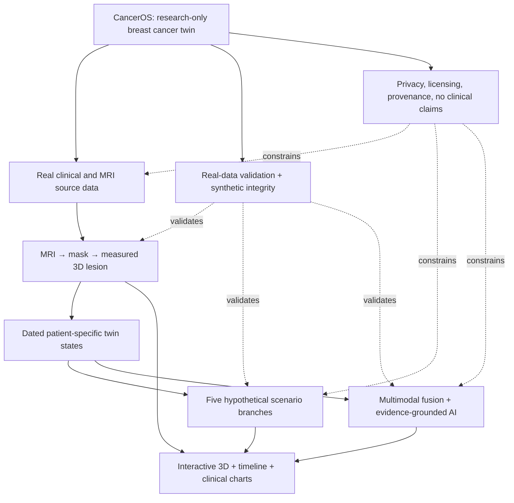

# CancerOS — Engineering Knowledge Map

**Document ID:** COS-KMAP-001  
**Version:** 1.0  
**Date:** 2026-10-25  
**Status:** Derived engineering navigation layer (not independently approved or implemented).

## Intended use

Use this map as an **implementation memory and retrieval index**. Before touching code, an agent should select nodes by requirement/domain, follow their dependency and safety links, reopen the authoritative numbered specifications, inspect tested upstream references, and create acceptance tests. Do not treat map completeness as proof of code or medical validity.

**Graph coverage:** 121 nodes, 269 typed relations, 6 major workflows. The machine-readable source is `canceros-knowledge-graph.json`.

## Authority hierarchy

1. Approved project specifications, with PRD for product scope; approved contracts for types and service interfaces.
2. Approved change decisions and validated test findings.
3. `COS-REF-001` for upstream investigation; academic references for review and scientific checks.
4. This knowledge map as the derived navigation and refresh layer.
5. Coding-agent assumptions must be documented and cannot overrule specifications.

## Design behavior map

## Reading the graph

- `HAS_DOMAIN`, `IMPLEMENTS`, `OWNS`, `TESTS`: what exists in the architecture.
- `PRECEDES`, `WORKFLOW_PRECEDES`: engineering dependencies and user journey.
- `CONSTRAINS`, `GUARDS`, `EXCLUDES`: non-negotiable safety or scope boundary.
- `VERIFIES`: where to obtain evidence for a capability.
- `REFERENCES`: sources to investigate, not automatically safe-to-copy code.

## Indexed capabilities by domain

### Clinical research data (`D.DATA`)

Authentic patient, imaging and clinical evidence, normalized but source-preserving.

- **DATA.SOURCE — Dataset and licensing registry** [P0]: Source identifier, version, DOI, license, acquisition date, restriction, attribution, approval.
- **DATA.PATIENT — ResearchPatient** [P0]: Stable pseudonymous internal patient key; mapping to protected source patient key.
- **DATA.DIAGNOSIS — CancerDiagnosis** [P0]: Verified subtype, stage, grade, ER/PR/HER2 and breast side; unknown stays unknown.
- **DATA.VISIT — ClinicalVisit** [P0]: Clinical encounter with timestamp and links to observations; do not conflate visit and scan.
- **DATA.STUDY — ImagingStudy** [P0]: Study with modality, source UID, scan date and acquisition context.
- **DATA.SERIES — ImagingSeries** [P0]: Acquisition/contrast phase with orientation, spacing, origin and physical coordinate transform.
- **DATA.SEG — SegmentationArtifact** [P0]: Mask whose semantics, source image, class, quality and provenance are known.
- **DATA.LESION — Lesion** [P0]: Persistent lesion identity with verified or reviewed cross-visit correspondence.
- **DATA.MEASURE — TumorMeasurement** [P0]: Method-defined longest diameter/volume and unit; volume distinct from RECIST diameter.
- **DATA.LABS — LaboratoryResult** [P0]: Collection time, analyte code, value, unit, source and reference metadata.
- **DATA.VITAL — VitalSign** [P0]: Date, physiologic value, unit and provenance.
- **DATA.SYMPTOM — SymptomObservation** [P0]: Structured symptom with explicit severity scale, negation and date.
- **DATA.TREAT — TreatmentEvent** [P0]: Time-indexed exposure category, known status, regimen/setting where available.
- **DATA.NOTE — ClinicalNote** [P0]: Source text or synthetic note with context, negation and evidence spans.
- **DATA.OUTCOME — OutcomeObservation** [P0]: Recorded real endpoint or synthetic state; pCR distinct from MRI response.
- **DATA.PROV — ProvenanceRecord** [P0]: Real observed, real derived, synthetic generated, interpolated or model predicted with parent, version and hash.
- **DATA.BRANCH — SimulationBranch** [P0]: Immutable hypothesis path originating from real baseline; never overwrites actual history.
- **DATA.RUN — SimulationRun** [P0]: Versioned generator settings, seed, status, logs and validator outcomes.
- **DATA.ARTIFACT — Artifact** [P0]: Source DICOM, NIfTI, mask, mesh or report with checksum, access control and transformations.

### Medical imaging (`D.IMG`)

MRI loading, preprocessing, masks, measurements, geometric representations and spatial quality.

- **IMG.INGEST — DICOM and NIfTI ingestion** [P0]: Validate study, series, sequence, privacy, slice sorting, pixel geometry and checksums.
- **IMG.PRE — MRI preprocessing** [P0]: Resampling, orientation standardization, intensity normalization, crop and transforms are versioned.
- **IMG.MASK — Mask classification and import** [P0]: Expert segmentation versus analysis ROI versus bounding box; masks must represent claimed structure.
- **IMG.MODEL — Optional automated segmentation** [P1]: Use validated masks first; nnU-Net/MAMA-MIA only when weights, domain and outputs verified.
- **IMG.VOL — Quantitative measurement** [P0]: Compute mask volume using physical voxel geometry; derive only supported dimensions.
- **IMG.REG — Longitudinal registration** [P0]: Use rigid/affine as warranted, explicit quality gate; numerical comparisons may survive registration failure.
- **IMG.TRACK — Cross-visit lesion identity** [P0]: Curated or verified lesion association across genuine studies, never inferred from proximity alone.
- **IMG.MESH — Mask-to-mesh conversion** [P0]: Marching cubes or tested equivalent; apply physical transform and preserve mask-authoritative measurements.
- **IMG.SYNMESH — Synthetic lesion geometry** [P0]: Transform baseline mask to target volume with validated geometry, label synthetic; no fabricated follow-up MRI.
- **IMG.VIEW — Web MRI viewer** [P0]: OHIF/Cornerstone3D integration or tested alternative for authentic MRI and overlays.

### Digital twin (`D.TWIN`)

Patient-specific observation states, meshes, timelines and branch isolation.

- **TWIN.BASELINE — Immutable real baseline** [P0]: The source patient and measurements remain authentic, and untouched by any simulated branch.
- **TWIN.STATE — Time-indexed state** [P0]: State binds patient, timestamp, geometry, clinical observations, treatment events, quality, missingness and provenance.
- **TWIN.HISTORY — Append-only historical updates** [P0]: Adding new observation creates new data/version, triggers selective downstream reanalysis.
- **TWIN.BRANCH — Scenario branch isolation** [P0]: All branches share source baseline but maintain isolated descendant records.
- **TWIN.TIME — Timeline alignment** [P0]: Different scan, lab, symptoms and intervention dates are retained even in a selected visit summary.
- **TWIN.COMPARE — Change analysis** [P0]: Compare appropriate lesion and clinical values with units, comparability and uncertainty.
- **TWIN.REAL — Genuine longitudinal viewing** [P0]: At least one real repeated-imaging case, kept separate from hypothetical trajectories.

### Synthetic longitudinal engine (`D.SIM`)

Five hypothetical trajectories with treatment events, clinical values and uncertainty.

- **SIM.ELIG — Treatment and scenario eligibility** [P0]: Known receptor status, setting and assumptions gate plausible exposures; unknown cannot silently pass.
- **SIM.RESPONSE — Family 1: strong response** [P0]: Hypothetical sustained tumor shrinkage, independent adverse effects.
- **SIM.STABLE — Family 2: partial/stable** [P0]: Hypothetical small reduction or near stability, measurement noise separate.
- **SIM.PROGRESS — Family 3: progression** [P0]: Hypothetical increasing burden; not automatically confirmed resistance.
- **SIM.REGROW — Family 4: response then regrowth** [P0]: Hypothetical reduction followed by growth, preserve intermediate inflection.
- **SIM.TOXIC — Family 5: clinical deterioration** [P0]: Potential worsening labs/symptoms independent of tumor burden, not proven drug causality.
- **SIM.EXPOSURE — Treatment exposures** [P0]: Chemo, endocrine, HER2 targeted, selected immunotherapy, surgery/radiotherapy as time-indexed events.
- **SIM.LATENT — Latent evolution state** [P0]: Simulated underlying tumor burden and clinical condition separated from noisy measurement generator.
- **SIM.OBS — Observation simulation** [P0]: Timestamped labs, vitals, symptoms, imaging geometry, notes, irregular sampling and missingness.
- **SIM.SEED — Reproducibility** [P0]: Pinned simulator, parameters, seed, source baseline, configuration hash.
- **SIM.VALID — Simulation validation** [P0]: Reject structural, temporal, unit, cross-modal, geometry, provenance and unsafe interpretation failures.
- **SIM.BATCH — Cohort branching target** [P0]: Initial planning up to 100 unique baseline patients, five branches each, four dated states; not independent real patients.

### Multimodal intelligence (`D.AI`)

Deterministic analysis, constrained NLP, retrieval and validated narrative interpretation.

- **AI.FEAT — Deterministic multimodal features** [P0]: Measurements and comparisons computed by typed services, not hallucinated by LLM.
- **AI.NLP — Clinical note extraction** [P0]: Extract typed, supported facts with date, negation, certainty and source span.
- **AI.FUSE — Late multimodal fusion** [P0]: Combine imaging, labs, vitals, symptoms, notes, treatment and missingness with provenance, conflict status.
- **AI.TEMP — Temporal analysis** [P0]: State history, trends and baselines, irregular intervals and known input scope.
- **AI.FORECAST — Optional future-state forecasts** [P0]: Only with qualified independent real-data evaluation; abstain otherwise. Synthetic simulator is not predictive validation.
- **AI.KNOW — Clinical knowledge representation** [P0]: Versioned source-linked relationships among observed patient entities and curated medical concepts.
- **AI.RETR — Evidence retrieval** [P0]: Curated NCI/PubMed-type sources, verifiable passage IDs, publication version and permissions.
- **AI.LLM — Grounded explanation** [P0]: Structured interpretation referencing exact measurements, provenance, evidence, uncertainty and limits.
- **AI.GUARD — Output safety validation** [P0]: Numerical grounding, citation validity, hallucination/unsafe claims, prompt-injection defense, abstention.
- **AI.FALLBACK — AI outage tolerance** [P0]: Twin measurements and viewing continue when external model is unavailable.

### Researcher experience (`D.UX`)

Case browser, image views, 3D tumor, timeline, scenario and AI evidence panels.

- **UX.CASE — Research case browser** [P0]: Pseudonymous case listing, source metadata, completeness and access.
- **UX.PROFILE — Patient context** [P0]: Known subtype/receptor, available studies, visits, uncertainty and source.
- **UX.3D — Interactive lesion viewport** [P0]: Rotate, pan, zoom, reset; clearly distinguish observed/synthetic/illustrative geometry.
- **UX.TIMELINE — Observation/date selector** [P0]: Synchronize 3D, clinical charts, date, treatment markers and state provenance.
- **UX.SCENARIO — Scenario generation/exploration** [P0]: Select eligible case, treatment exposure and 5 families; show assumptions, progress, validation and branches.
- **UX.CHART — Clinical charts** [P0]: Labs, vitals, symptoms, treatments with units and exact observation dates; no invented readings.
- **UX.INSIGHT — AI insights with evidence** [P0]: Findings with source links, uncertainties, conflicts and research-only limitation.
- **UX.IMPORT — New observation workflow** [P0]: Validate added clinical or image observation; append state and recompute dependencies.
- **UX.EVAL — Evaluation/limitations view** [P0]: What was tested, real versus synthetic metrics, cohort size, unknowns and known failures.
- **UX.FAIL — Graceful empty/error states** [P0]: No nonfunctional controls, sensible missing-image state, no stale insight falsely current.

### Scientific evaluation (`D.EVAL`)

Technical correctness and honest real-data evaluation separate from simulation tests.

- **EVAL.PHANTOM — Geometry phantom tests** [P0]: Known millimeter cubes/ellipsoids to verify units, transforms, mask volume and mesh.
- **EVAL.SEG — Imaging segmentation metrics** [P0]: Dice, HD95, measured volume error on relevant held-out expert masks, no unsupported claims.
- **EVAL.REAL — Authentic longitudinal case evaluation** [P0]: Track genuine repeat scans separately; error against actual holdout outcomes if forecasting used.
- **EVAL.SIM — Simulation integrity evaluation** [P0]: Plausibility review, parameter assumptions, correlations, chronology, reproducibility and missingness.
- **EVAL.AI — NLP/LLM grounding evaluation** [P0]: Extraction, negation, citation validity, numerical fidelity, clinical abstention and adversarial notes.
- **EVAL.E2E — End-to-end demo** [P0]: One MRI → mask → measurable mesh → five synthetic scenarios → timeline → AI interpretation.
- **EVAL.REPORT — Scientific limitations report** [P0]: Cohort size, methods, source licenses, real/synthetic distinction and unvalidated claims.

### Platform infrastructure (`D.INFRA`)

Backend API, persistence, object storage, workers, jobs, deployment and security.

- **INF.API — Backend API contracts** [P0]: Typed FastAPI/other selected API, auth, versioning and error contracts.
- **INF.DB — Clinical database** [P0]: PostgreSQL logical entities, integrity keys, migrations and isolation.
- **INF.OBJECT — Imaging/object storage** [P0]: Private originals, derivatives, meshes, signed read paths and checksums.
- **INF.JOBS — Async imaging jobs** [P0]: Bounded-memory CPU preparation, remote GPU when needed, status, retry and idempotence.
- **INF.DEPLOY — Deployment** [P0]: Reproducible build, health checks, secure secrets, cost and demo recovery.
- **INF.CI — Continuous verification** [P0]: Unit/integration/e2e tests, static checks, version pinning and audit logs.

### Safety and provenance (`D.GOV`)

Licensing, patient de-identification, traceable origin, abstention and research-only boundary.

- **GOV.REAL — Immutable source truth** [P0]: Original observed records never silently altered or overwritten.
- **GOV.PROV — Five provenance classes** [P0]: REAL_OBSERVED, REAL_DERIVED, SYNTHETIC_GENERATED, INTERPOLATED, MODEL_PREDICTED.
- **GOV.PRIV — Privacy and access** [P0]: Pseudonyms, deidentification checks, role-aware access, approved external data processing only.
- **GOV.LIC — License separation** [P0]: Check source-code, dataset, model-checkpoint and outputs independently; CC BY-NC use needs review.
- **GOV.NOCLIN — No autonomous care** [P0]: No diagnoses, prescriptions, therapy ranking, survival promises or fabricated clinical efficacy.
- **GOV.RECIST — Formal response boundary** [P0]: Tumor volume labels never automatically RECIST categories or pathology complete response.
- **GOV.CTCAE — Adverse-event grading boundary** [P0]: CTCAE grade only when exact evidence and versioned rule requirements satisfied.
- **GOV.ABSTAIN — Disclose unknowns** [P0]: Missing values, poor registration, lack of calibrated forecast or uncertain evidence yield caveat/abstention.

## Key patient/user workflows

### WF.REAL: Real imaging vertical slice

DATA.SOURCE → DATA.PATIENT → IMG.INGEST → IMG.PRE → IMG.MASK → IMG.VOL → IMG.MESH → UX.3D → EVAL.PHANTOM

### WF.SIM: Synthetic scenario vertical slice

TWIN.BASELINE → SIM.ELIG → SIM.LATENT → SIM.OBS → IMG.SYNMESH → SIM.VALID → TWIN.BRANCH → UX.TIMELINE

### WF.NEW: Add observation

UX.IMPORT → DATA.VISIT → TWIN.HISTORY → TWIN.COMPARE → AI.FEAT → UX.INSIGHT

### WF.AI: Evidence linked interpretation

AI.NLP → AI.FEAT → AI.FUSE → AI.RETR → AI.LLM → AI.GUARD → UX.INSIGHT

### WF.REALVAL: Actual longitudinal evaluation

IMG.INGEST → IMG.REG → IMG.TRACK → TWIN.REAL → EVAL.REAL → EVAL.REPORT

### WF.RELEASE: Demo readiness

EVAL.E2E → EVAL.AI → GOV.PROV → GOV.PRIV → INF.DEPLOY → EVAL.REPORT

## Safety invariants

- **GOV.REAL** Immutable source truth: Original observed records never silently altered or overwritten.
- **GOV.PROV** Five provenance classes: REAL_OBSERVED, REAL_DERIVED, SYNTHETIC_GENERATED, INTERPOLATED, MODEL_PREDICTED.
- **GOV.PRIV** Privacy and access: Pseudonyms, deidentification checks, role-aware access, approved external data processing only.
- **GOV.LIC** License separation: Check source-code, dataset, model-checkpoint and outputs independently; CC BY-NC use needs review.
- **GOV.NOCLIN** No autonomous care: No diagnoses, prescriptions, therapy ranking, survival promises or fabricated clinical efficacy.
- **GOV.RECIST** Formal response boundary: Tumor volume labels never automatically RECIST categories or pathology complete response.
- **GOV.CTCAE** Adverse-event grading boundary: CTCAE grade only when exact evidence and versioned rule requirements satisfied.
- **GOV.ABSTAIN** Disclose unknowns: Missing values, poor registration, lack of calibrated forecast or uncertain evidence yield caveat/abstention.

## Explicit exclusions

- X.WHOLE — Whole-body digital twin
- X.MULTI — Multiple cancers
- X.CARE — Clinical diagnosis/prescription
- X.SURV — Validated prognosis/survival prediction
- X.GENOME — Whole-genome/cell-scale simulation
- X.HOSP — Production EHR/hospital integrations
- X.DRUG — Drug discovery or causal therapy optimization
- X.PHOTOMRI — Synthetic follow-up scans represented as authentic MRI

## Source status and gaps

- The twelve core specifications were reported drafted by the project owner; their formal acceptance, code status, exact file contents and reconciliation have not been independently verified in this deliverable.
- Model checkpoints, licenses, data field coverage, dataset access, inference compatibility and registration quality must be checked in the real development environment.
- A synthetic simulator can be structurally correct without being clinically validated.
- Formal RECIST labels require proper criteria; volume decrease is not automatically a RECIST response.
- Clinical data must not be exported to an LLM until dataset permissions and provider handling are approved.

## Change protocol

For any change: state the node ID, linked source requirement(s), proposal, clinical or architectural consequences, updated dependency edges, added tests, and approval. Keep immutable prior release copies.

## Agent refresh protocol

1. State the task and target requirements.
2. Fetch the relevant domain nodes and 1–2 edge hops in the JSON graph.
3. Read every connected `CONSTRAINS` rule and `VERIFIES` test.
4. Reopen the corresponding sections of the original specifications and any reference audit.
5. Identify source facts, proposed methods and still-unverified claims.
6. Implement smallest coherent slice behind established typed contracts.
7. Execute tests and record actual results; update node implementation status only with evidence.

## Sources

- `PRD` = `COS-PRD-001`
- `DATA` = `COS-SPEC-003`
- `SIM` = `COS-SPEC-004`
- `IMG` = `COS-SPEC-005`
- `AI` = `COS-SPEC-006`
- `REF` = `COS-REF-001`
- `ARCH` = `COS-SPEC-007`
- `API` = `COS-SPEC-008`
- `UX` = `COS-SPEC-009`
- `SAF` = `COS-SPEC-010`
- `TEST` = `COS-SPEC-011`
- `ROAD` = `COS-SPEC-012`
