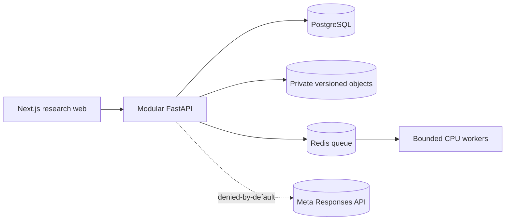

# CancerOS Phase 6 technical and evidence package
<!-- COS-097 reviewable package: concise entry, honest limits, no external send. -->

## Purpose and scope
Research-only breast-cancer twin prototype: authorized observed baseline, five
explicitly hypothetical scenario families, synchronized clinical timeline and
evidence-linked comparison. No diagnosis, staging, prescribing, treatment
ranking, survival or treatment-success prediction.

## Quick start (local, no cloud spend)
```powershell
uv sync --locked
npm.cmd ci
npm.cmd run contracts:generate
npm.cmd run build
uv run python scripts/bootstrap_tools.py
uv run python scripts/dev.py start foundation
uv run python scripts/worker_smoke.py
uv run python scripts/dev.py stop foundation
```

## Architecture (as deployed locally)

Logical modules versus real services: the web, API, database, objects, queue
and workers above are real local processes. No Kubernetes, GPU estate or cloud
network services are deployed in this scope. The provider gateway is a closed
local path until a verified export policy and credentials exist.

## Data lineage and trust boundary
Observed source → immutable snapshot → derived measurements/meshes → synthetic
branches (SYNTHETIC_GENERATED, never promoted) → grounded rule-based summaries.
Judges read published output only; editors write in an isolated project with an
authorized presenter. Signed grants are short-lived and renewable only by a new
authorized grant.

## Evaluation evidence index
| Report | Result |
|---|---|
| `docs/engineering/evidence/release-suite.json` | passed (fixture) |
| `docs/engineering/evidence/geometry-benchmark.json` | passed (technical only) |
| `docs/engineering/evidence/longitudinal-gate.json` | blocked (D02) |
| `docs/engineering/evidence/synthetic-plausibility.json` | passed (no realism claim) |
| `docs/engineering/evidence/nlp-retrieval-challenge.json` | passed (fixture) |
| `docs/engineering/evidence/safety-adversary.json` | passed (finite suite) |
| `docs/engineering/evidence/candidate-report.json` | blocked for full readiness |
| `docs/engineering/evidence/staging-deployment.json` | plan only, not deployed |
| `docs/engineering/evidence/storage-recovery.json` | blocked (no restore run) |
| `docs/engineering/evidence/worker-operations.json` | bounds documented |
| `docs/engineering/evidence/security-hardening.json` | static gates pass |
| `docs/engineering/evidence/observability-cost.json` | estimates only |
| `docs/engineering/evidence/smoke-rollback.json` | blocked (no target) |
| `docs/engineering/evidence/demo-cases-synthetic.json` | blocked (no artifacts) |
| `docs/engineering/evidence/demo-case-longitudinal.json` | blocked (D02) |
| `docs/engineering/evidence/demo-fixtures.json` | passed (fixture) |

## Claim ledger (demonstrated / measured_on_named_test_set / proposed / not_evaluated)
- Fixture-tested demo journeys across five Phase 6 suites: demonstrated on
  named synthetic fixtures, not on real data.
- Geometry and measurement checks: measured on the frozen benchmark set;
  technical correctness only, not clinical accuracy.
- Synthetic plausibility rules: measured on the frozen regression; real-lab
  similarity not_evaluated; qualified review blocked.
- Longitudinal chronology and forecast accuracy: not_evaluated (D02 blocked).
- Cloud deployment, recovery, billed costs, participant review: not_evaluated.
- No accuracy, certification, affiliation, finalist or organizer-provided
  access/credit claim is made anywhere in this package.

## Submission manifest rules
Include: source tree hashes, pinned dependencies, runbooks, versioned evidence
above, architecture visuals and the public-safe brief. Exclude: secrets and
`.env` values, linkage maps, raw restricted notes/scans, unapproved weights,
signed grants and sensitive logs. Images and video only where permitted and
labeled recorded/static/saved. Restricted evidence stays referenced through
authorized access, never copied into a public archive.
