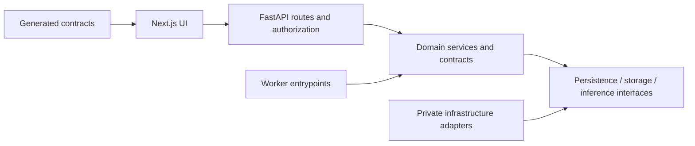

# Module boundaries

COS-004. One modular application, not a service per folder. Root Python distribution
uses src/canceros and is installed by uv; logical packages below are ownership/docs
and contract artifacts, not assumed implicitly importable Python packages.

| Path | Owner and permitted dependency direction |
| --- | --- |
| apps/web | UI and generated TypeScript contracts; calls API, never DB/provider credentials |
| services/api | HTTP app entry point; authenticates/authorizes, validates, invokes services |
| packages/contracts | Canonical schema ownership; generated JSON/OpenAPI/TypeScript output |
| packages/clinical | Clinical concepts/time/units; no provider SDKs or UI imports |
| packages/imaging | Scientific imaging services; no HTTP/UI ownership |
| packages/simulation | Hypothetical generation; never edits observed source history |
| packages/intelligence | Structured findings and grounding; no measurement invention |
| src/canceros | Installed Python implementation of the above responsibilities |
| workers | Entrypoints invoking the same installed domain/adapter code |
| infrastructure | Local service configuration/runbooks; no clinical truth |
| migrations | Numbered database changes; integrity enforced in DB and services |
| tests | Artificial public fixtures and negative/integration checks |
| fixtures | Explicit engineering-only nonclinical examples |
| scripts | Reproducible checks, generation and startup tools |
| docs | Original evidence plus distinct decisions and implementation state |

Persistence implements domain interfaces. Provider and storage SDKs live behind
adapters; no domain imports of UI/provider code. Workers cannot bypass ownership,
publication or export guards. Calculations, simulation and model narrative remain
separate. Boundary checks become executable as modules appear; current directory
plans alone are not import verification.
